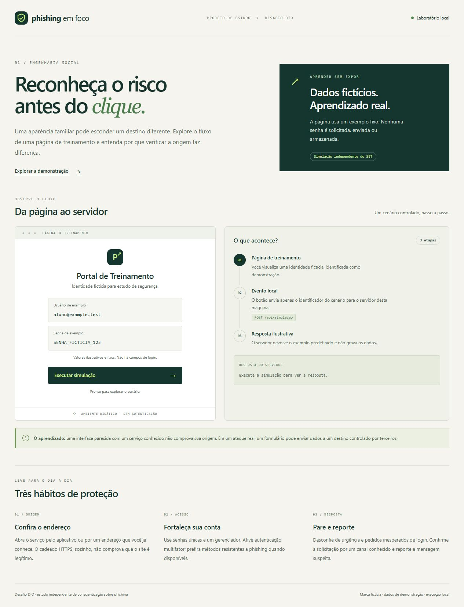
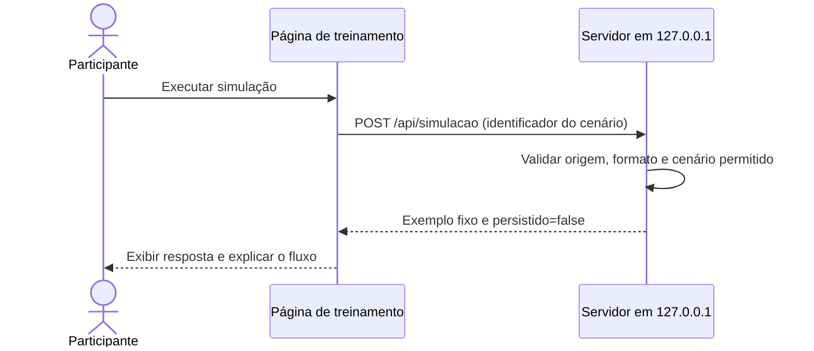
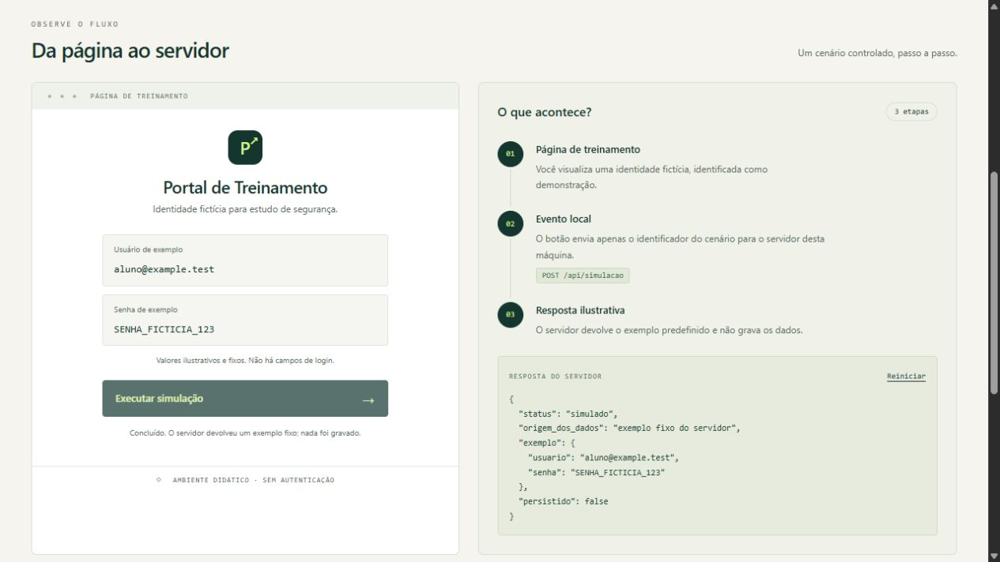

# Phishing em foco — laboratório educacional

Projeto de estudo inspirado no desafio de phishing da DIO. Apresenta uma demonstração local, uma análise do fluxo de dados e medidas de prevenção, com documentação e testes reproduzíveis.

> **Escopo desta versão:** adaptação didática com identidade fictícia e exemplos fixos. O SET não foi executado e não há clonagem do Facebook ou coleta de senhas. Esta entrega não comprova o requisito original de executar o laboratório com o SET. A aceitação desta adaptação depende dos critérios do curso.



## Objetivo

Entender como uma interface pode induzir confiança e por que é necessário verificar a origem de uma página antes de autenticar. A proposta também exercita documentação técnica, organização de um repositório e validação de comportamento HTTP.

O [repositório-base do desafio](https://github.com/cassiano-dio/cibersecurity-desafio-phishing) apresenta uma atividade com Kali Linux e SET. Este projeto é uma implementação independente: substitui o cenário original por uma demonstração identificada como treinamento e explicita suas limitações.

## O que foi implementado

- Página responsiva em português, com uma marca fictícia.
- Exibição de usuário e senha de exemplo, sem campos editáveis.
- Simulação de uma requisição HTTP e visualização da resposta JSON.
- Servidor vinculado exclusivamente a `127.0.0.1`.
- Validação de Host, Origin, formato e tamanho da requisição.
- Conteúdo sobre identificação de phishing e proteção de contas.
- Dez testes automatizados usando recursos nativos do Node.js.
- Relatório técnico, capturas de tela e roteiro de publicação no GitHub.

## Executar localmente

Requisito: **Node.js 20 ou superior**. Não há pacotes externos para instalar.

No terminal, entre na pasta do projeto:

```bash
cd desafio-phishing-educacional
node server.mjs
```

Abra **http://127.0.0.1:8765** no navegador. Clique em **Executar simulação** e observe a resposta. **Reiniciar** limpa a visualização e permite repetir o cenário. Para encerrar o servidor, use `Ctrl+C` no terminal.

Também é possível iniciar com `npm start`. Abrir somente `dist/index.html` não executa o servidor necessário à demonstração.

Se a porta estiver ocupada, escolha outra:

```powershell
# PowerShell
$env:LAB_PORT = '8766'
node server.mjs
```

```bash
# Linux/macOS
LAB_PORT=8766 node server.mjs
```

Use o endereço `127.0.0.1` impresso no terminal. A validação de Host rejeita endereços diferentes, inclusive `localhost`.

## Como a demonstração funciona



A requisição contém somente:

```json
{"cenario":"dados-ficticios"}
```

O servidor retorna valores predefinidos:

```json
{
  "status": "simulado",
  "origem_dos_dados": "exemplo fixo do servidor",
  "exemplo": {
    "usuario": "aluno@example.test",
    "senha": "SENHA_FICTICIA_123"
  },
  "persistido": false
}
```

**O usuário e a senha exibidos na resposta não vieram do navegador.** São constantes ilustrativas definidas em `server.mjs`. O sistema não autentica contas, não acessa serviços externos e não grava requisições em arquivos ou banco de dados. Dados extras são rejeitados sem serem reproduzidos na resposta.



## Decisões técnicas

| Decisão | Motivo |
| --- | --- |
| Identidade fictícia e identificação de treinamento | Tornar explícito o caráter didático da página |
| Apenas um identificador de cenário no POST | Demonstrar o caminho da requisição sem solicitar credenciais |
| Dados fixos no servidor | Permitir repetição e comparação do resultado |
| Node.js sem dependências externas | Simplificar a execução e a revisão do código |
| Escuta em loopback, validação de Host e Origin | Restringir a demonstração ao contexto local previsto |
| Rotas estáticas permitidas explicitamente | Evitar que arquivos do repositório sejam servidos por engano |
| Limite de 256 bytes e política CSP | Restringir o formato da demonstração e os recursos da página |
| Sem persistência ou logs de requisição | Reduzir os dados tratados pelo laboratório |

Os controles delimitam o escopo desta implementação; não representam uma aplicação de autenticação pronta para produção. O sistema operacional, o navegador ou ferramentas externas ainda podem manter seus próprios registros.

## Verificação

Execute na raiz do projeto:

```bash
node --test
```

Ou use `npm test`.

Na validação de **13/10/2026**, com Node.js **v24.19.0**, os **10 testes passaram**. Eles cobrem execução local, carregamento dos assets, cenário permitido, rejeição de campos extras, origem e Host indevidos, acesso a arquivos não públicos, formato inválido, corpo grande e comportamento de `HEAD`.

A interação de executar e reiniciar também foi verificada no navegador. Veja os detalhes e limites em [Relatório técnico](docs/RELATORIO.md) e a [saída dos testes](docs/VALIDACAO.txt).

## Aprendizados e prevenção

Uma página semelhante a um serviço conhecido não comprova sua origem. Na demonstração, o botão inicia um evento limitado; em um ataque, um formulário pode encaminhar informações a terceiros.

Verificar a origem, confirmar solicitações inesperadas por um canal conhecido, usar senhas únicas e reportar mensagens suspeitas são hábitos de prevenção. A CISA reúne orientações em [Secure Our World](https://www.cisa.gov/secure-our-world).

A autenticação multifator reduz riscos, mas os métodos não oferecem a mesma proteção. Quando disponível, prefira autenticação resistente a phishing. Consulte a [orientação da CISA sobre MFA resistente a phishing](https://www.cisa.gov/sites/default/files/2023-01/fact-sheet-implementing-phishing-resistant-mfa-508c.pdf).

HTTPS protege o transporte da conexão; sua presença isolada não comprova que a página pertence ao serviço esperado.

## Organização

```text
.
├── README.md
├── LICENSE
├── .gitignore
├── package.json
├── server.mjs
├── dist/
│   ├── index.html
│   ├── styles.css
│   ├── app.js
│   └── favicon.svg
├── tests/
│   └── server.test.mjs
├── images/
│   ├── 01-demonstracao.jpg
│   ├── 02-resultado.jpg
│   └── 03-mobile.jpg
└── docs/
    ├── RELATORIO.md
    ├── ESTUDO-SET.md
    ├── VALIDACAO.txt
    └── ENTREGA.md
```

## Relação com a entrega DIO

| Item | Situação desta versão |
| --- | --- |
| README e arquivos explicativos | Preparados |
| Demonstração local com dados fictícios | Implementada e testada |
| Capturas de tela da demonstração | Incluídas |
| Uso prático do SET | Não realizado; consultar [Estudo do SET](docs/ESTUDO-SET.md) |
| Clonagem do Facebook | Fora do escopo desta adaptação |
| Todas as aulas assistidas | Deve ser confirmado pelo participante |
| Repositório público e envio na DIO | Pendentes; seguir o [roteiro de entrega](docs/ENTREGA.md) |

## Referências

- [Desafio original — cassiano-dio](https://github.com/cassiano-dio/cibersecurity-desafio-phishing).
- [SET — documentação oficial do Kali](https://www.kali.org/tools/set/).
- [Social-Engineer Toolkit — TrustedSec](https://github.com/trustedsec/social-engineer-toolkit).
- [GitHub — criar um repositório](https://docs.github.com/pt/repositories/creating-and-managing-repositories/creating-a-new-repository).

## Licença

O código original desta implementação está disponível sob a licença [MIT](LICENSE). Os projetos e materiais referenciados mantêm suas próprias licenças. Projeto independente de estudo, sem vínculo oficial com DIO, Meta ou TrustedSec.
